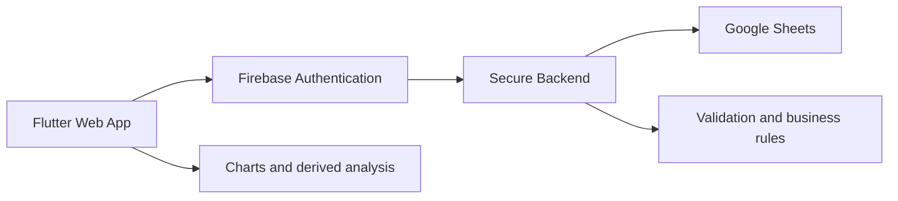

# Accountable schema and architecture review

This document reviews the current test tables in [`test_sheets/`](./test_sheets/) and records recommendations for the Accountable financial-tracking web app.

## Overall recommendation

Use Google Sheets as:

1. A small source-of-truth financial ledger.
2. Reference and configuration tables.
3. Exchange-rate history.
4. Optional daily snapshots for reconciliation and historical accuracy.

Use the Flutter app for:

- Form validation.
- Transaction entry.
- Filtering.
- Aggregation.
- Charts and trend analysis.
- Responsive presentation.
- Derived calculations that are not authoritative records.

Avoid reproducing AppSheet's denormalized or configuration-heavy structure unless it serves a real application need.

## Table-by-table feedback

### [`Transactions.csv`](./test_sheets/Transactions.csv)

This should remain the primary financial ledger.

#### Strengths

- One row per financial event.
- Supports expenses, income, reimbursements, and transfers.
- Separate source and destination accounts support transfers.
- `created_at` and `date` distinguish entry time from transaction date.

#### Issues and recommendations

##### Currency is selected by account

Each account has one currency. Selecting an account therefore determines the currency for that side of the transaction, including cross-currency transfers.

For a cross-currency transfer, the app will store the entered source and destination amounts. A separate transfer exchange rate is not required for the current scope; the relationship between the two entered amounts is sufficient.

##### Amount semantics need to be documented

Current conventions appear to be:

- Expense uses `source_amount`.
- Income uses `dest_amount`.
- Reimbursement uses `dest_amount`.
- Transfer uses both amounts.

The app should enforce these rules consistently.

##### Categories, transaction types, currencies, and tags

Categories should remain in Sheets because they are financial data that may later be referenced by budget groups. Use a stable category key and a display name so names can change without rewriting historical transactions. Future budget rules can reference one or more category keys.

Transaction types and currencies can remain repository configuration because they are relatively stable application definitions.

Tags can participate in future budgeting, so keep a Tags table with a stable `tag_id` and editable `tag_name`. Transactions should store the stable tag key, with at most one tag per transaction initially.

Do not put budget amounts directly in the Tags table yet. When budgeting is implemented, a separate budget configuration can reference category keys and/or tag keys, allowing budget rules to evolve without changing the tag taxonomy.

##### Dates and timezones

Use UTC for timestamps such as `created_at` and `retrieved_at`. Use the user's local calendar date for the transaction `date` column.

#### Canonical transaction contract

| Type | Source account | Source amount | Destination account | Destination amount | Category |
|---|---|---|---|---|---|
| Expense | Required | Required | Empty | Empty | Required |
| Income | Empty | Empty | Required | Required | Optional or income category |
| Reimbursement | Empty | Empty | Required | Required | Required |
| Transfer | Required | Required | Required | Required | Empty |

### [`Accounts.csv`](./test_sheets/Accounts.csv)

#### Strengths

- Stable account IDs.
- Account currency.
- Opening balance and opening date.
- Closing date supports historical accounts.

#### `current_balance` recommendation

`current_balance` is a formula calculated from the opening balance and all transactions. It is therefore derived data rather than an independent source of truth.

The app should reproduce the same calculation for analysis and validation. Keeping the formula in Sheets is acceptable during the transition, but the app should not treat the stored value as an externally reported bank balance.

Also consider adding `is_active`; retain `closing_date` for historical filtering.

### [`DailyAccountBalances.csv`](./test_sheets/DailyAccountBalances.csv)

These rows are calculated from transaction data and are intentionally retained as materialized daily history for performance. The app should use them for long-range charts and historical views instead of rebuilding every view from all transactions.

The initial rebuild implementation should be a full rebuild for simplicity. It should be able to recreate all three `Daily*` tables from transactions and exchange rates.

The desired daily workflow is:

1. Around 12:15, retrieve the previous day's Frankfurter exchange rates.
2. If the requested date has no usable rate, use the most recent available prior rate.
3. Add the previous day's rows to `DailyExchangeRates`, `DailyAccountBalances`, and `DailyNetWorth`.
4. Provide a full-rebuild action for regenerating all derived daily rows.

The scheduled implementation and deployment location are intentionally deferred. The code should remain in this repository even if it is eventually deployed as a remote scheduled backend job.

### [`DailyExchangeRates.csv`](./test_sheets/DailyExchangeRates.csv)

This should remain a source-of-truth table if historical net worth must be reproducible.

It currently includes the historical date, currency, USD conversion rate, and retrieval timestamp.

Recommended additions:

```text
base_currency
rate_provider
```

Define fallback behavior for missing rates:

1. Use the exact date.
2. Use the most recent prior date.
3. Show the value as unconverted with a visible warning.

The app should use the rate associated with the valuation or transaction date, not necessarily today's rate.

### [`DailyNetWorth.csv`](./test_sheets/DailyNetWorth.csv)

This is fully derived:

```text
daily net worth = sum(account balance * exchange rate)
```

Usually calculate it in the app. Keep the table only if it is a durable historical snapshot or a performance cache.

If retained, consider adding:

```text
calculation_version
source_snapshot_timestamp
```

This helps explain why a historical value changed.

### [`Categories.csv`](./test_sheets/Categories.csv)

Categories should remain in Sheets as user-managed reference data, especially because future budgeting will need to group categories without requiring an app redeployment.

The current `allowed_transaction_types` comma-separated field is unnecessary. The app can define valid categories for each transaction type directly in code, while still reading the category list and display names from Sheets.

The file also contains an empty row before `salary`, which should be removed during migration.

Use a stable `category_id` or category key in transaction rows, separate from `category_name`. This allows a category to be renamed without rewriting historical transactions and gives future budget groups a reliable reference.

### [`TransactionTypes.csv`](./test_sheets/TransactionTypes.csv)

This is mostly AppSheet-style metadata.

The following fields can be represented directly in application code:

- `source_side_required`.
- `destination_side_required`.
- `expense_multiplier`.

Either remove this table and use a Dart enum with validation rules, or keep only a simple configuration table if transaction types must be added without redeploying the app.

`expense_multiplier` is opaque. Explicit behavior is clearer:

```text
expense: increases spending
income: increases income
reimbursement: decreases spending
transfer: excluded from income and spending
```

### [`Currencies.csv`](./test_sheets/Currencies.csv)

This table is reasonable and can remain if more currencies are expected.

If only USD and INR will ever be supported, it could be represented in code, but keeping it as a small reference table is harmless and more extensible.

A future version may include:

```text
currency_id
currency_symbol
decimal_places
display_name
is_active
```

### [`Tags.csv`](./test_sheets/Tags.csv)

Tags are primarily trip-oriented labels, but they may also become a budgeting dimension. Keep [`Tags.csv`](./test_sheets/Tags.csv) with a stable `tag_id` and editable `tag_name`. One tag per transaction is sufficient initially.

Budget amounts should not be added directly to the Tags table yet. A future budget configuration can reference tag keys and category keys separately or together.

## What can be removed from Sheets?

### Strong candidates for removal or migration into code

- [`TransactionTypes.csv`](./test_sheets/TransactionTypes.csv), including its validation flags and multiplier.
- [`Currencies.csv`](./test_sheets/Currencies.csv), if currency definitions remain small and static.

### Tables to keep

- [`Transactions.csv`](./test_sheets/Transactions.csv).
- [`Accounts.csv`](./test_sheets/Accounts.csv), with `current_balance` remaining a derived formula during the transition.
- [`Categories.csv`](./test_sheets/Categories.csv), including stable category keys for future budgeting.
- [`Tags.csv`](./test_sheets/Tags.csv), including stable tag keys for future budgeting.
- [`DailyExchangeRates.csv`](./test_sheets/DailyExchangeRates.csv).
- [`DailyAccountBalances.csv`](./test_sheets/DailyAccountBalances.csv), as a materialized daily calculation cache.
- [`DailyNetWorth.csv`](./test_sheets/DailyNetWorth.csv), as a materialized daily calculation cache.

## Where should calculations happen?

### More calculations in Google Sheets

#### Advantages

- The app mostly displays data.
- Calculations are easy to inspect manually.
- Other spreadsheet users can see the results.
- Some results are available even if the app is offline.
- Operational reconciliation can remain spreadsheet-based.

#### Disadvantages

- Formulas become difficult to maintain.
- Google Sheets becomes slow with larger datasets.
- Logic is harder to test.
- Concurrent edits can create problems.
- Complex formulas and Apps Script become fragile.
- The app must understand spreadsheet-specific calculation behavior.

### More calculations in the app

#### Advantages

- Strong typing and reusable code.
- Easier automated testing.
- Better filtering and chart performance.
- Easier to support multiple views.
- Easier to change business rules.
- Less duplicated data in Sheets.

#### Disadvantages

- The app must download more raw data.
- Large datasets may become slow.
- Historical results require carefully defined rules.
- Multiple clients could calculate inconsistent results if versions differ.
- Sensitive data is closer to the client unless protected by a backend.

### Recommended boundary

Use Sheets for:

- Transactions.
- Accounts.
- Categories and stable category keys.
- Tags and stable tag keys.
- Daily exchange rates.
- Materialized daily account balances.
- Materialized daily net worth.

Use repository configuration for:

- Currencies, if they remain static.
- Transaction types and validation rules.

Use the app or backend for:

- Validation.
- Current account balances from transactions.
- Spending and income totals.
- Category aggregation.
- Date-range filtering.
- Period comparisons.
- Net worth charts.
- Trend calculations.
- Display formatting.
- Full rebuilds of the derived daily tables.

The daily tables are intentionally retained as calculation caches for long-range analysis. The app should use them for historical views and use transaction data for current or detailed views where appropriate.

## Recommended architecture



The browser should ideally not receive unrestricted Google Sheets access.

A safer flow is:

1. The user signs in with Google through Firebase Authentication.
2. The app obtains a Firebase ID token.
3. A backend validates the token.
4. The backend reads or writes the appropriate Sheets data.
5. The backend rejects unauthenticated or unauthorized requests.

Possible backend choices:

- Firebase Cloud Functions.
- Google Apps Script with careful authentication and authorization.
- A small server using the Google Sheets API.

Do not expose a Google service-account key or unrestricted spreadsheet access in Flutter web code.

## Firebase timing

Set up the final authentication path once, before connecting the app to real financial data, but not necessarily before building the UI. Use Firebase Google sign-in plus one secure backend credential path for Sheets rather than a temporary direct-Sheets integration followed by a later replacement.

Recommended sequence:

1. Build screens using local CSV test data.
2. Create a data-access interface so the UI does not depend directly on Google Sheets.
3. Add Firebase Authentication and the secure Sheets backend path.
4. Use the same path with the real spreadsheet once access control is working.

Fast Flutter/Chrome iteration should remain practical because the data source is configurable. Support two modes:

- Local CSV files with the same table filenames as the Sheets tables.
- The real Google Sheets backend.

Use local CSV mode by default during UI development. Do not use a separate test Google Sheet unless it becomes necessary later.

## Mobile app recommendations

Because mobile is the primary target, use a responsive web layout rather than a desktop-first fixed layout.

### Main navigation

Use four or five primary areas:

- Overview.
- Transactions.
- Accounts.
- Analysis.
- Settings.

On mobile, use a bottom `NavigationBar`. On wider web layouts, use a navigation rail or sidebar.

### Transaction entry

Use a prominent floating action button or Add Transaction button.

Provide:

- Quick expense.
- Quick income.
- Transfer.
- Reimbursement.
- Full transaction form.

Quick forms should produce the same canonical transaction row as the full form.

### Overview screen

Prioritize:

- Current net worth.
- Total account balances.
- Spending for the selected period.
- Income for the selected period.
- Recent transactions.
- A compact net-worth trend chart.

### Analysis screen

Support:

- Date-range selection.
- Spending by category.
- Income by category.
- Account balances.
- Net worth over time.
- Comparison with a previous period.
- Currency conversion display.
- Filtering by account, category, tag, and transaction type.

### Mobile UX

Use:

- Bottom sheets for filters.
- Large touch targets.
- Safe-area handling.
- Sticky date-range controls.
- Paginated or lazy-loaded lists.
- Clear loading, empty, and error states.
- Confirmation before submitting financial entries.
- Optimistic UI only when failed writes can be safely retried.

## Implementation plan

### Phase 1: Data contract

Define:

- Transaction type rules.
- Amount semantics.
- Account-selected currencies.
- UTC timestamps and local transaction dates.
- Balance calculation rules.
- Missing exchange-rate behavior.
- Full rebuild rules for the calculated daily tables.
- At most one optional stable tag key per transaction.

Budgeting is intentionally deferred. Categories should nevertheless retain stable keys in Sheets now, so future budget groups can reference multiple categories without changing the basic transaction model. Budget groups, recurring monthly limits, and account-transfer goals can be added later.

### Phase 2: Data access abstraction

Create separate interfaces for:

- Reading accounts.
- Reading transactions.
- Reading exchange rates.
- Adding transactions.
- Reading reference data.

Start with a mock or CSV implementation.

### Phase 3: Core app shell

Build:

- Responsive navigation.
- Overview page.
- Transaction list.
- Account list.
- Loading and error states.
- Responsive desktop-web and mobile-width layouts.

### Phase 4: Transaction entry

Implement:

- Expense form.
- Income form.
- Transfer form.
- Reimbursement form.
- Shared validation.
- Canonical transaction-row generation.

### Phase 5: Calculations and analysis

Implement and test:

- Account balances.
- Net worth.
- Spending totals.
- Income totals.
- Category breakdowns.
- Period comparisons.
- Charts and trends.

### Phase 6: Authentication and secure backend

Add:

- Firebase Google sign-in for the single intended user.
- One final secure backend path for Sheets access.
- Backend access control.
- Secure Sheets reads and writes.
- Error handling for permission and network failures.
- A scheduled daily job that retrieves the previous day's Frankfurter rate and writes the three daily derived rows, once the deployment approach is decided.

### Phase 7: Migration

Migrate the real data only after:

- The schema is finalized.
- Transactions have been validated.
- Historical balances have been reconciled.
- The real spreadsheet works end to end through the secure backend path.

## Confirmed decisions

- `Accounts.current_balance` is a formula derived from the opening balance and transactions.
- `DailyAccountBalances` and `DailyNetWorth` are calculated materialized tables used for performance and historical analysis.
- The app should use the daily tables for long-range views.
- Cross-currency transfers are supported; each account determines the currency for its side.
- A separate transfer exchange rate is not required initially.
- Timestamps use UTC; the transaction `date` uses the user's local calendar date.
- One optional tag is sufficient initially; Tags remain in Sheets with stable keys because they may later participate in budgeting.
- Categories remain in Sheets with stable category keys so future budget groups can reference them.
- Currencies and transaction types can be repository configuration.
- Transaction rows should store stable category keys; separate IDs are not needed for static transaction types or currencies.
- The app is intended for one user.
- Local CSV mode and real Google Sheets mode are the two planned data-source modes, with local CSV as the default during UI development.
- A full rebuild of all derived daily tables is preferred initially.
- The daily process should retrieve the previous day's Frankfurter rate, fall back to the most recent available prior rate, and write the previous day's rows to all three daily tables.
- Budgeting is future scope and should not be designed into the first implementation.

## Deferred decisions

- Where the scheduled daily job will be deployed. Its source code should remain in this repository regardless of deployment choice.
- The exact backend implementation for secure Google Sheets access.
- The detailed budgeting model.

The current structural recommendation is to keep **Transactions, Accounts, and DailyExchangeRates authoritative**, retain the daily balance and net-worth tables as materialized calculation caches, move AppSheet-specific metadata into repository configuration, and keep the initial app scope focused on transaction entry and analysis.
